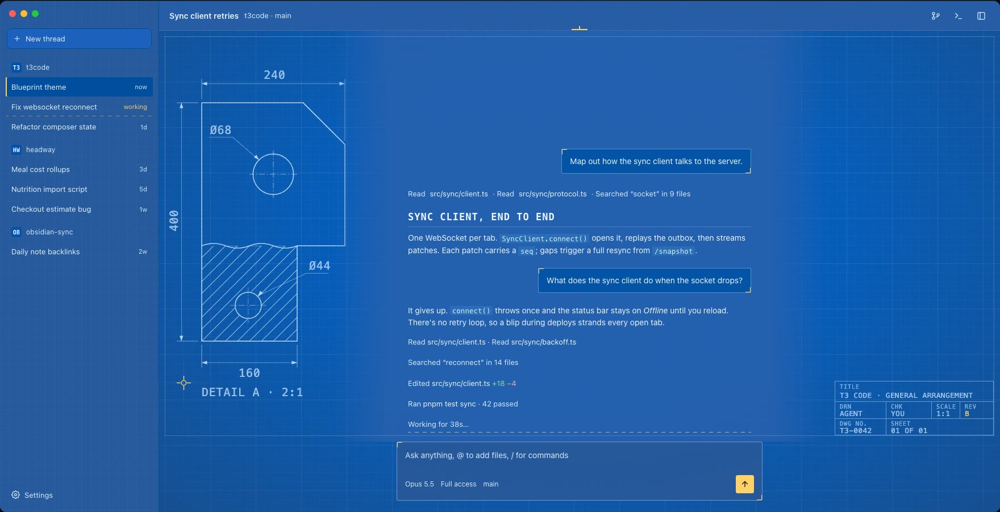

# Blueprint

**A cyanotype theme for [T3 Code](https://t3.codes).** While your agent works, a pen plotter inks a machined part in the margin. When the turn ends, the pen parks and the sheet holds still.

**[See it in motion →](https://joshsaintjacque.github.io/t3code-theme-blueprint/)**



## Install

**From the app**

1. Download [`blueprint.json`](blueprint.json), or copy its contents.
2. In T3 Code, open **Settings › Appearance › Add theme**.
3. Choose the file, or paste the JSON, and add it.

**From the terminal**

```sh
curl -fsSL -o blueprint.json https://joshsaintjacque.github.io/t3code-theme-blueprint/blueprint.json
~/.t3/bin/t3 theme set blueprint.json
```

`t3 theme set` publishes the file and sets it as the environment theme, so every client connected to that environment switches to it.

Tested on T3 Code v0.1.10 (nightly).

## What moves, and when

Every animation is tied to real app state. If nothing is running, nothing moves.

| | |
|---|---|
| **Pen plotter** | On wide windows the gutter beside the chat becomes a drafting table. During a turn, a plotter draws a bracket: outline, bores, section hatch, dimensions, callouts. Between turns you see the finished drawing, perfectly still. |
| **Gantry carriage** | A pencil carriage rides the header rail while the turn runs, then retracts. |
| **Marching pencil lines** | Busy threads in the sidebar, and the live *Working…* row, get a dashed yellow line that marches in steps. |
| **Composer** | Registration-mark corner ticks that extend on focus. |
| **Title block** | Drawn by the agent, checked by you. Rev B. |
| **Narrow windows** | No room beside the chat? The drawing docks under the sidebar. |

`prefers-reduced-motion` is respected throughout, in both the CSS and the SVGs.

## Palette

Blue is the paper, white is the ink, and yellow is reserved for things that need you: focus, send, and work in progress.

| Role | Hex |
|---|---|
| Canvas | `#2466C3` |
| Sidebar | `#265A9C` |
| Message | `#004F9C` |
| Text | `#EEF6FF` |
| Muted | `#D7EBFF` |
| Accent | `#FFD166` |
| Update | `#BEF0FF` |
| Error | `#FFA9A6` |

## Make your own variant

`blueprint.json` is generated. Edit [`source/build.py`](source/build.py) and run it:

```sh
python3 source/build.py
```

It rewrites `blueprint.json` and the preview SVGs in `assets/svg/`. T3 Code caps theme CSS at 20,000 characters, and the script prints the current count.

## Site

The landing page is a single `index.html` served by GitHub Pages from the root of `main`. The videos are a staged replica of the T3 Code window, styled with the theme's actual CSS, with made-up threads.

---

A community theme, not affiliated with or endorsed by T3 Code. [MIT licensed](LICENSE).
